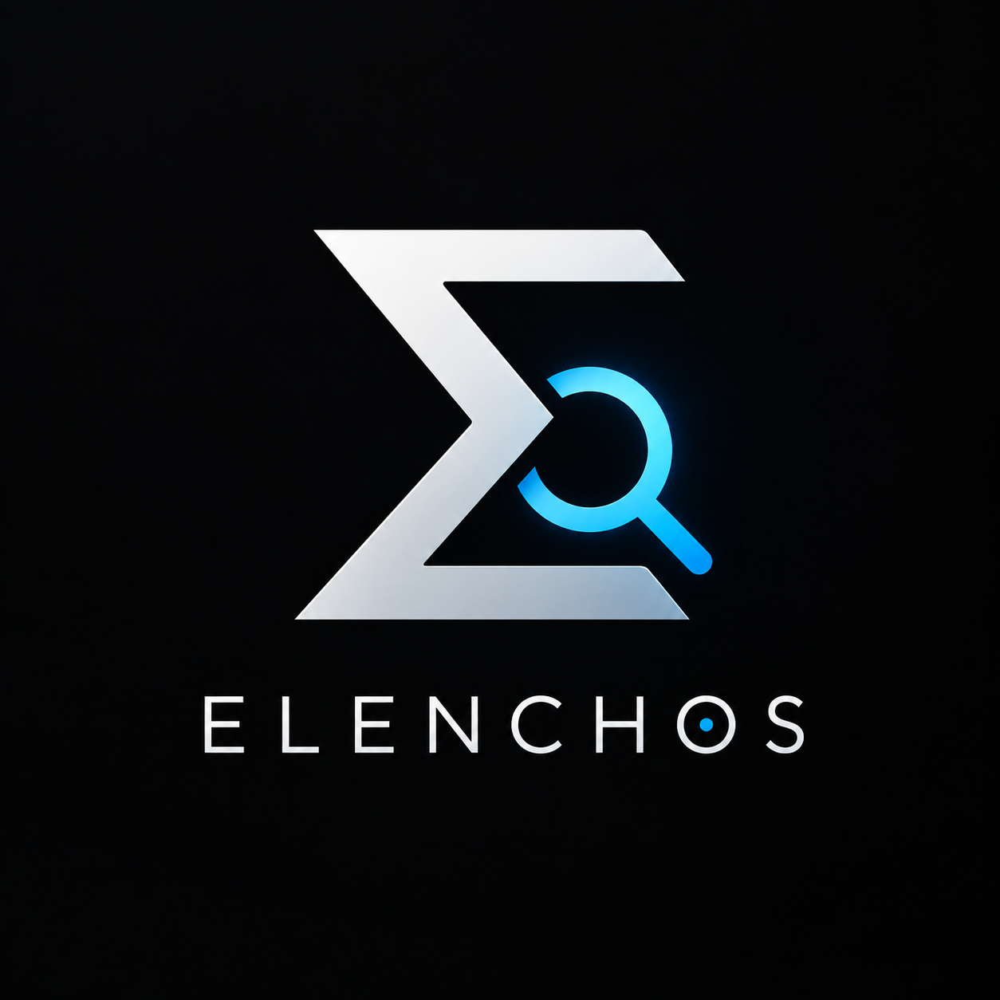
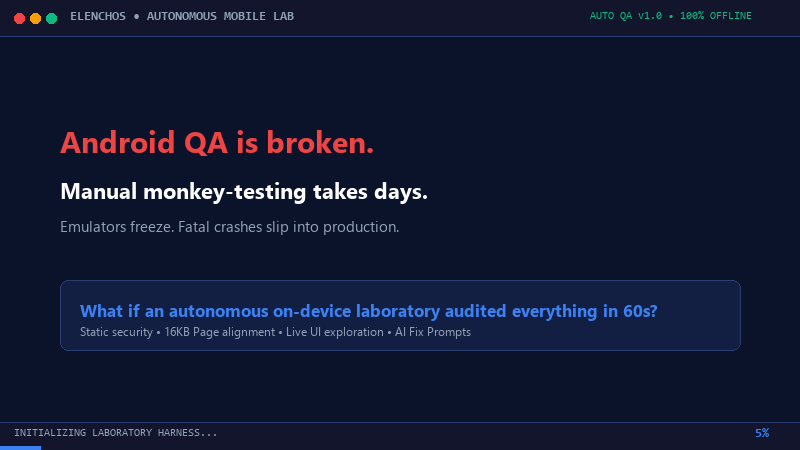

# Elenchos (ἔλεγχος)
### God-Tier Android Autonomous Mobile QA Laboratory

<p align="center">
  
</p>

<p align="center">
  <a href="https://github.com/CodeSorcerer-007/Elenchos/releases"></a>
  <a href="#"></a>
  <a href="#"></a>
  <a href="#"></a>
  <a href="#"></a>
  <a href="#"></a>
  <a href="#"></a>
</p>

---

<p align="center">
  
</p>

> **"Upload APK → Test Everything Possible → Find Problems → Prove Them → Explain Them → Give an AI Agent Everything Needed to Fix Them."**

**Elenchos (ἔλεγχος)** is a native, mobile-first Android developer testing laboratory engineered to run directly on physical Android devices and emulators. It empowers developers and mobile QA teams to import APKs via Storage Access Framework, perform deep static security and manifest audits, inspect 16KB page alignment in raw native ELF binaries, autonomously crawl active window hierarchies, fuzz boundary inputs, stress lifecycles, detect crashes and ANRs from logcat streams, and synthesize structured **AI Fix Packages** designed for autonomous AI coding agents (Claude, GPT-4o, Gemini, Antigravity).

---

## ⚡ Quick Start: Install Pre-Built APK

Download and install the hardened, R8-minified standalone release artifact directly via ADB:

```bash
# 1. Install pre-built standalone laboratory APK (3.7 MB)
adb install -r elenchos-v1.0-release.apk

# 2. Launch Elenchos Laboratory
adb shell am start -n com.example.elenchos/.MainActivity
```

---

## 🔬 The 14-Phase Autonomous Laboratory Pipeline

Elenchos executes an orchestrated 14-phase testing suite designed to uncover blocker defects, hidden security vulnerabilities, and crash regressions:

| Phase | Diagnostic Stage | Execution Mechanism | Key Invariants Audited |
|---|---|---|---|
| **01** | **APK Verification & Integrity** | Static Binary | SHA-256 integrity calculation, file size formatting, ZIP central directory index |
| **02** | **Static Security & Manifest Scan** | Rule Engine | `android:debuggable`, cleartext HTTP, exported components, backup exposure |
| **03** | **Target Installation Check** | Package Manager | Verifies whether target is installed for live UI execution vs headless sandbox |
| **04** | **Startup & Launch Latency** | Timing & Profiling | Resolves launcher intent, measures cold start latency footprint (ms) |
| **05** | **Screen Graph & UI Discovery** | Topological Mapper | Maps screen nodes and navigation transitions from component intent filters |
| **06** | **Automated UI Interaction** | Accessibility Service | Crawls active window node tree, auto-clicks interactive elements, scrolls containers |
| **07** | **Input Robustness & Fuzzing** | Boundary Mutator | Injects 26 boundary vectors (SQL mocks, Unicode overflows, extreme numeric limits) |
| **08** | **Navigation & Back Stack Stress** | Global Action Hook | Fires sequential `GLOBAL_ACTION_BACK` events; traps infinite cyclic navigation loops |
| **09** | **Lifecycle & State Preservation** | State Reconstitution | Audits pause/resume preservation, process-death bundle recovery, task reparenting |
| **10** | **Configuration & Orientation** | Display Matrix | Verifies layout stability during dynamic orientation changes & multi-window resizing |
| **11** | **Network Resilience** | Connectivity Manager | Audits offline state transitions and `ACCESS_NETWORK_STATE` permission handling |
| **12** | **Crash & ANR Diagnostics** | Logcat Stream Parser | Harvests uncaught runtime exceptions (`NPE`, `IOOBE`, `OOM`); deduplicates stack traces |
| **13** | **Issue Correlation & Deduplication**| Correlation Matrix | Consolidates identical root causes across screens into unified P0–P4 findings |
| **14** | **Health Score Synthesis** | Mathematical Model | Computes weighted 0–100 Health Score and generates structured AI Fix Packages |

---

## ⚙️ Dual-Engine Architecture

Elenchos provides **two concurrent testing modes** based on device permissions:

```
┌────────────────────────────────────────────────────────────────────────┐
│                      Elenchos Testing Harness                          │
└────────────────────────────────────────────────────────────────────────┘
                                    │
           Is ElenchosLabAccessibilityService Enabled?
                                    │
                  ┌─────────────────┴─────────────────┐
                  ▼                                   ▼
             [ YES ]                               [ NO ]
  ⚡ Live Autonomous Testing Mode        🔬 Deterministic Sandbox Mode
  • Real-time window tree crawling       • Deep static manifest audit
  • Live auto-tapping & scrolling        • 16KB native library ELF audit
  • Boundary fuzz typing into fields     • DEX string pool secret scan
  • Traps system crash/ANR dialogs       • Computed latency & screen graph
  • Global back-stack loop testing       • Zero elevated permissions needed
```

1. **⚡ Live Autonomous Exploration Mode:** Powered by `ElenchosLabAccessibilityService`. When enabled in Accessibility Settings, Elenchos inspects live window hierarchies, auto-taps interactive views, types boundary fuzz strings into focused fields, scrolls containers, and traps OS crash alerts.
2. **🔬 Deterministic Sandbox & Manifest Audit Mode:** When accessibility privileges are not granted, Elenchos operates in an isolated sandbox. It performs deep cryptographic verification, 16KB ELF alignment audits, AXML manifest decoding, DEX credential scanning, and logcat crash monitoring without fabricating results.

---

## 🛡️ Deep APK Intelligence & Native Binary Analysis

### 1. 16KB Page Alignment Verification (Android 15 / 16)
Beginning with Android 15, devices configured with 16KB page sizes require all 64-bit native `.so` libraries to have their `PT_LOAD` segments aligned on 16KB boundaries (0x4000). Elenchos inspects raw APK ZIP central directory records and parses 64-bit ELF headers directly:
- Validates that native `.so` files are stored **uncompressed** (`method == STORED`) for direct memory mapping (`mmap`).
- Verifies local header data offsets are multiples of 16384 bytes.
- Traverses 64-bit ELF program headers (`Elf64_Phdr`) and verifies that each `PT_LOAD` segment has `p_align >= 16384`.

### 2. Binary AXML Manifest Parser
Elenchos features a built-in, low-level binary Android XML (AXML) parser capable of extracting attributes from compiled manifests without external dependencies:
- Little-endian parsing of RES_XML chunks (`0x00080003`).
- UTF-8 and UTF-16LE string pool decoders.
- Direct inspection of security-critical attributes such as `android:usesCleartextTraffic`, `android:debuggable`, and `android:allowBackup`.

### 3. DEX String Pool Credential Scanner
Streaming scanner inspects compiled `classes.dex` string tables with cross-chunk carryover buffers to detect hardcoded client secrets:
- Google API Keys (`AIza...`)
- AWS Access Key IDs (`AKIA...`)
- GitHub Personal Access Tokens (`ghp_...`)
- RSA/EC Private Key PEM blocks
- Hardcoded localhost/staging endpoints (`http://10.0.2.2`, `http://localhost`)

---

## 📐 Mathematical Health Scoring Model

Elenchos calculates a deterministic **Overall Health Score (0 – 100)** based on an audited, weighted mathematical formula:

$$\text{Health Score} = 0.25 \times \text{Stability} + 0.25 \times \text{Security} + 0.20 \times \text{Functionality} + 0.10 \times \text{Performance} + 0.10 \times \text{Accessibility} + 0.10 \times \text{Compatibility}$$

### Sub-Score Derivations

| Dimension | Weight | Primary Factors & Penalty Deductions |
|---|:---:|---|
| **Stability** | 25% | Deductions: P0 Blocker (-40), P1 Critical (-25), P2 High (-10), P3 Medium (-3) |
| **Security** | 25% | Deductions for `debuggable="true"`, cleartext traffic, exposed services/providers, leaked secrets |
| **Functionality**| 20% | Ratio of discovered vs exercised interactive controls; launcher availability penalty (-25) |
| **Performance** | 10% | Package bloat penalties (>80MB: -20, >40MB: -10), cold startup latency, multidex footprint |
| **Accessibility**| 10% | Audit of content descriptions, touch target ergonomics, missing element descriptions |
| **Compatibility**| 10% | Android 15 16KB alignment failure (-25), targetSdk < 34 (-20), missing 64-bit native ABIs (-30) |

---

## 🤖 AI Fix Package & Agent Handoff

Elenchos bridges the gap between issue detection and code remediation by synthesizing structured **AI Fix Packages**:

### One-Click Agent Prompt
Pressing **`COPY AI FIX PROMPT`** generates a comprehensive prompt tailored for autonomous coding agents (Claude, GPT-4o, Gemini, Antigravity):

```markdown
You are a senior Android software engineer. Fix all confirmed issues found by Elenchos.
Target: com.example.targetapp v2.4 (SDK 35, Min SDK 24)
Laboratory Health Score: 88 / 100

ISSUES TO RESOLVE:
[P0 BLOCKER] Application packaged with android:debuggable='true'
  - File: AndroidManifest.xml (<application>)
  - Fix: Ensure android:debuggable="false" in release build variants.

[P1 CRITICAL] Exported ContentProvider without permission guard
  - Component: com.example.targetapp.data.LocalDataProvider
  - Fix: Add android:exported="false" or configure read/write permissions.
```

### Deterministic JSON Schema
Exports a machine-readable JSON package containing project metadata, device environment, health score subscores, deduplicated issues, reproduction steps, stack traces, and root cause hypotheses.

---

## 🔒 Privacy & Sandboxing Guarantee

- **100% Offline & Local-First:** Elenchos **does not declare the `android.permission.INTERNET` permission** in its manifest. It is physically blocked by the Android OS sandbox from transmitting target APK bytecode, crash logs, or findings to external networks.
- **Isolated Process Execution:** Foreign APK bytecode is never dynamically executed inside the Elenchos process; all runtime inspection respects Android OS sandbox boundaries.
- **Instant Data Purge:** One-click "Clear All Test Data" purges all imported artifacts, logs, and sessions from private storage (`context.filesDir`).

---

## 🏗️ Codebase Architecture

```text
com.example.elenchos/
├── domain/model/
│   └── Models.kt               # Pure immutable @Serializable models (APKArtifact, TestSession, Issue, HealthScore)
├── data/
│   ├── apk/
│   │   └── ApkParser.kt        # Deep ZIP, DEX, AXML, 16KB ELF alignment & secret scanner
│   └── storage/
│       ├── ITestLabRepository.kt # Repository interface
│       └── TestLabRepository.kt  # Mutex-locked local file & JSON persistence
├── di/
│   └── AppContainer.kt         # Lightweight, zero-reflection dependency injection container
├── testing/
│   ├── static/
│   │   └── StaticSecurityAnalyzer.kt  # Rule-based manifest, component, and security auditor
│   └── runtime/
│       ├── ITestRunnerEngine.kt       # Engine interface
│       ├── TestRunnerEngine.kt        # 14-phase testing orchestrator with abort support
│       ├── InputFuzzer.kt             # 26 boundary, Unicode, and numeric fuzzing vectors
│       ├── LogcatMonitor.kt           # Logcat reader, exception parser, crash deduplicator
│       └── phases/
│           ├── TestPhase.kt           # TestPhase interface & PhaseExecutionContext
│           ├── EarlyPhases.kt         # Verification, Security, Install, Latency, ScreenGraph
│           ├── InteractionPhases.kt   # Live UI, Fuzzing, BackStack, Lifecycle, Orientation
│           └── DiagnosticPhases.kt    # Network, Crash diagnostics, Correlation, Score synthesis
├── service/
│   └── ElenchosLabAccessibilityService.kt  # Accessibility service for live UI crawling
├── reporting/
│   ├── AIFixPackageGenerator.kt       # AI JSON package & senior engineer prompt builder
│   ├── MarkdownReportGenerator.kt     # Full technical markdown report
│   ├── HtmlReportGenerator.kt         # Self-contained HTML report with responsive styling
│   └── BugTrackerFormatter.kt         # GitHub Issue & Jira ticket formatter
├── theme/
│   ├── Color.kt                       # Light laboratory palette & severity tokens
│   ├── Type.kt                        # Technical typography (Segoe UI / Roboto / Monospace)
│   └── Theme.kt                       # Light-only developer laboratory theme
└── ui/
    ├── components/
    │   └── LabComponents.kt           # HealthScoreGauge, LabCard, SeverityBadge, TerminalConsoleView
    ├── screens/
    │   ├── HomeScreen.kt              # Dashboard & test launcher
    │   ├── ProjectsScreen.kt          # APK intelligence summary & component inspector
    │   ├── TestLabScreen.kt           # Live cockpit & real-time terminal console
    │   ├── ReportsScreen.kt           # Health score breakdown & execution mode badge
    │   ├── IssueExplorerScreen.kt     # Searchable & filterable P0-P4 issue explorer
    │   ├── AIFixPackageScreen.kt      # AI prompt handoff & JSON export
    │   ├── HistoryScreen.kt           # Session history & Run A vs Run B diff comparison
    │   └── SettingsScreen.kt          # Accessibility toggle, test budgets, & privacy controls
    ├── navigation/
    │   └── NavigationScreen.kt        # Screen enum definitions
    ├── viewmodel/
    │   └── ElenchosViewModel.kt       # Central StateFlow ViewModel
    └── MainActivity.kt                # Edge-to-edge Compose activity
```

---

## 🛠️ Building & Verifying Locally

### Prerequisites
- JDK 17 or JDK 21 (`JAVA_HOME` configured)
- Android SDK Platform 36 & Build-Tools 35.0.0+

### Execute Unit Test Suite
```bash
./gradlew test
```
*Executes all 74 unit tests across 14 test classes (`BUILD SUCCESSFUL`).*

### Assemble Release APK (R8 Minified)
```bash
./gradlew assembleRelease
```
*Generates hardened, obfuscated standalone APK at `app/build/outputs/apk/release/app-release.apk`.*

### Assemble Debug APK
```bash
./gradlew assembleDebug
```
*Generates debug APK at `app/build/outputs/apk/debug/app-debug.apk`.*

---

## 📄 License
Elenchos is distributed under the **Apache License 2.0**. See `LICENSE` for details.
